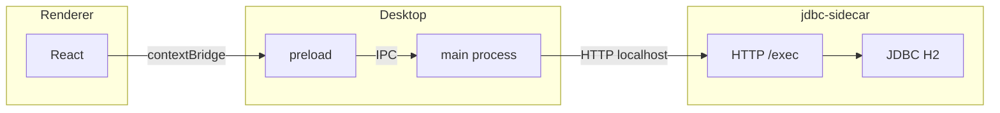

# Monorepo `apps` — SPCE desktop

Aplicação desktop (Electron) com UI em React e acesso a dados via **JDBC** em processo separado (JVM), para evitar drivers nativos no Node.

## Pacotes

| Pasta | Descrição |
|-------|-----------|
| **`renderer/`** | React 19 + Vite 8 + TypeScript. UI com **shadcn/ui** (preset Nova: Radix, Tailwind v4, Geist). Arquitetura em camadas: `domain`, `infrastructure`, `presentation`. |
| **`desktop/`** | Shell **Electron**: janela, preload (`contextBridge`), IPC `api:invoke` e cliente HTTP para o jdbc-sidecar. |
| **`shared/`** | Pacote **`@spce/shared`**: tipos e constantes do IPC (`ApiEndpoint.exec`, `SqlExecInput`, etc.). Compila para CommonJS em `dist/` (uso no main do Electron). No renderer, o Vite resolve o **fonte TypeScript** via alias (evita conflito ESM/CJS no browser). |
| **`jdbc-sidecar/`** | Servidor HTTP em **Java** (Javalin + HikariCP + H2). Expõe `POST /exec` para executar SQL; `GET /health`. Usa **Maven Wrapper** (`./mvnw`), sem necessidade de Maven global. |

## Fluxo de dados



1. O renderer chama `window.api.invoke` (exposto no preload).
2. O **main** do Electron encaminha para o **jdbc-sidecar** (`127.0.0.1`, porta padrão **18080**).
3. O sidecar executa o SQL no H2 (TCP) e devolve JSON `{ query, results }`.

## Pré-requisitos

- **Node** 20+ (recomendado 24) e **Yarn** 4.
- **JDK** 11+ para compilar/rodar o jdbc-sidecar (o `pom.xml` usa `release` 11).
- **Servidor H2** acessível na rede (host/porta configurados no sidecar ou por variáveis de ambiente).

## Como desenvolver

### 1. jdbc-sidecar (terminal 1)

```bash
cd jdbc-sidecar
yarn dev
# ou: ./mvnw -q exec:java
```

Variáveis úteis (opcionais; há defaults no código):

| Variável | Exemplo |
|----------|---------|
| `JDBC_SIDECAR_PORT` | `18080` |
| `JDBC_URL` | URL JDBC completa (substitui montagem por host) |
| `H2_USER` / `H2_PASSWORD` | Credenciais H2 |
| `H2_TCP_PORT` | Porta TCP do servidor H2 (ex.: `9092`) |

### 2. Desktop + Vite (terminal 2)

```bash
cd desktop
yarn dev
```

Sobe o Vite do **renderer** em `http://127.0.0.1:5173` e abre o Electron apontando para essa URL.

### 3. Só o renderer (sem Electron)

```bash
cd renderer
yarn dev
```

Útil para layout estático; **não** há `window.api` — chamadas ao banco falham até rodar pelo Electron.

## Builds

### Artefatos parciais

```bash
# Tipos IPC (CommonJS) — usado pelo main do Electron
cd shared && yarn build

# UI estática (saída em renderer/dist — empacotada no instalador)
cd renderer && yarn build

# JAR único do jdbc-sidecar (shade → jdbc-sidecar/target/jdbc-sidecar.jar)
cd jdbc-sidecar && yarn build
```

O Electron em modo **desenvolvimento** (`yarn dev` no `desktop/`) usa o Vite em `http://127.0.0.1:5173`. Em **produção empacotada**, o `main` carrega `renderer/dist/index.html` via `loadFile` (o `vite.config` usa `base: './'`).

### Build de release (executável / instalador)

Na raiz **`apps/`**, um único comando gera **shared** → **renderer** → **jdbc-sidecar (Maven)** → **pacote Electron** ([electron-builder](https://www.electron.build/) no `desktop/`):

```bash
yarn build:release
```

Saída em **`desktop/release/`**, por exemplo no Linux x64:

| Artefato | Descrição |
|----------|-----------|
| **AppImage** (`SPCE-<versão>.AppImage`) | Executável portátil (Linux). |
| **deb** (`desktop_<versão>_amd64.deb`) | Pacote Debian; o nome segue o campo `name` do `package.json` do desktop (ajuste `homepage` e metadados se mudar o projeto). |

Equivalente só no pacote desktop (exige JAR e `renderer/dist` já gerados):

```bash
cd desktop && yarn build:desktop
```

Ou, no `desktop/`, `yarn build:release` roda `build` do renderer + shared e em seguida o electron-builder.

### O que entra no pacote

- **Código Electron** (`main.js`, `preload.js`, `sidecar-client.js`, `sidecar-process.js`, dependências de produção, `@spce/shared`).
- **`renderer/dist/`** copiado para dentro do app (caminho em produção: `renderer/dist/` relativo ao `main` no asar).
- **`jdbc-sidecar.jar`** em **`extraResources`** → em runtime: `process.resourcesPath/sidecar/jdbc-sidecar.jar`.

### Runtime na máquina do usuário

- **Java (JRE/JDK)** deve estar disponível: o app empacotado inicia o sidecar com `java -jar` (usa `JAVA_HOME` se existir; senão o comando `java` no **PATH**).
- O instalador **não** inclui uma JVM embutida; isso reduz tamanho e evita licenciamento por plataforma. Para embutir JRE no futuro, dá para estender `extraResources` e apontar o spawn para esse binário.
- **`SPCE_SKIP_EMBEDDED_SIDECAR=1`**: não inicia o JAR embutido (útil para depuração com sidecar externo). Em desenvolvimento não empacotado, o sidecar continua sendo o processo manual (`yarn dev:sidecar` ou `./mvnw`).

### Plataformas

- O **electron-builder** gera instaladores para o **SO atual** (no Linux, AppImage + deb conforme `desktop/package.json` → `build.linux`).
- **Windows** (NSIS) e **macOS** (DMG) estão configurados em `build.win` / `build.mac`; builds nativos exigem rodar o comando na plataforma alvo (ou CI com runners adequados). Ícones customizados: campo `build` no `package.json` / pasta `build/` (ver documentação do electron-builder).

### Configuração relevante

- Metadados e alvos: **`desktop/package.json`** (`build.appId`, `build.productName`, `homepage` — necessário para o alvo **deb**).

## Yarn e `@spce/shared`

- Nos pacotes **renderer** e **desktop**, a dependência é **`portal:../shared`** (symlink; no desktop usa-se **`nodeLinker: node-modules`** em `.yarnrc.yml` por compatibilidade com o binário do Electron).
- Após alterar tipos em `shared/`, rode `yarn build` em **`shared/`** (o `prepare` também compila na instalação).

## Estrutura interna do `renderer` (resumo)

- **`src/domain/`** — entidades, contratos de repositório, casos de uso.
- **`src/infrastructure/`** — adaptadores (ex.: `ElectronSqlExecutionAdapter`), implementações de repositório, DI (`DIContainer`, containers por domínio).
- **`src/presentation/`** — controllers e view models para a UI.
- **`src/components/ui/`** — componentes gerados pelo **shadcn**.

## MCP / Cursor

Em **`renderer/.cursor/mcp.json`** (e opcionalmente em **`.cursor/mcp.json`** na raiz `apps/`) pode existir configuração do MCP **shadcn** para o Cursor (`npx shadcn@latest mcp`).

---

Documentação focada na pasta **`apps/`**; repositórios ou pastas irmãs fora de `apps` não entram neste escopo.
