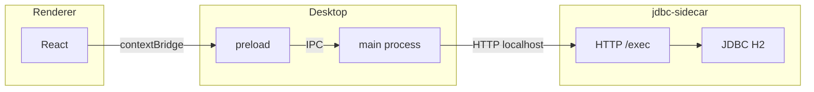

# Monorepo `apps` — SPCE desktop

Aplicação desktop (Electron) com UI em React e acesso a dados via **JDBC** em processo separado (JVM), para evitar drivers nativos no Node.

## Pacotes

| Pasta | Descrição |
|-------|-----------|
| **`renderer/`** | React 19 + Vite 8 + TypeScript. UI com **shadcn/ui** (preset Nova: Radix, Tailwind v4, Geist). Arquitetura em camadas: `domain`, `infrastructure`, `presentation`. |
| **`desktop/`** | Shell **Electron**: janela, preload (`contextBridge`), IPC `api:invoke` e cliente HTTP para o jdbc-sidecar. |
| **`shared/`** | Pacote **`@spce/shared`**: tipos e constantes do IPC (`ApiEndpoint.exec`, `SqlExecInput`, etc.). Compila para CommonJS em `dist/` (uso no main do Electron). No renderer, o Vite resolve o **fonte TypeScript** via alias (evita conflito ESM/CJS no browser). |
| **`jdbc-sidecar/`** | Servidor HTTP em **Java** (Javalin + HikariCP + H2). Expõe `POST /exec` para executar SQL; `GET /health`. Usa **Maven Wrapper** (`./mvnw`), sem necessidade de Maven global. |

## Fluxo de dados



1. O renderer chama `window.api.invoke` (exposto no preload).
2. O **main** do Electron encaminha para o **jdbc-sidecar** (`127.0.0.1`, porta padrão **18080**).
3. O sidecar executa o SQL no H2 (TCP) e devolve JSON `{ query, results }`.

## Pré-requisitos para desenvolvimento

- **Node** 20+ (recomendado 24) e **Yarn** 4.
- **JDK** 11+ para compilar e rodar o jdbc-sidecar em modo dev (o `pom.xml` usa `release` 11).
- **Servidor H2** acessível na rede quando você testar contra o banco real (host/porta via variáveis de ambiente ou corpo da requisição).

## Pré-requisitos na máquina do cliente

Estes itens valem para quem instala o **aplicativo empacotado** (AppImage, `.deb`, instalador Windows, DMG macOS), não para quem só clona o repositório e desenvolve.

### O que não é necessário no cliente

- **Node.js**, **Yarn** ou **Maven** — o instalador já traz o runtime do Electron e os arquivos da UI; o sidecar vai como **JAR** nos recursos do app.

### Obrigatório: Java

- O processo **jdbc-sidecar** é iniciado com `java -jar` no próprio computador do usuário. É necessário um **JRE ou JDK na versão 11 ou superior** (o código do sidecar é compilado com **Java 11**).
- O sistema deve encontrar o executável **`java`** no **PATH**, ou você pode definir **`JAVA_HOME`** apontando para a instalação do JDK/JRE (o app repassa isso ao subprocesso quando aplicável).
- O instalador **não** inclui uma JVM embutida; o usuário (ou o departamento de TI) precisa instalar Java por conta própria (ex.: Eclipse Temurin, Oracle JDK, distribuição corporativa).

### Sistema operacional e hardware

- Usar o instalador **compatível com o SO e com a arquitetura** da máquina (por exemplo **Windows x64** ou **Linux x64**, conforme o que foi gerado no build).
- No **Linux**, AppImages podem exigir permissão de execução (`chmod +x`) e, em alguns ambientes, suporte a **FUSE** / `libfuse2` para montar a imagem.
- Ambiente **gráfico** (sessão desktop): não é aplicação pensada para servidor sem interface.

### Rede e banco de dados

- O sidecar abre um servidor HTTP em **localhost** (porta padrão **18080**; configurável por **`JDBC_SIDECAR_PORT`** no ambiente do processo). Em condições normais **não** é preciso abrir porta no firewall para a internet; tráfego é local.
- A aplicação acessa o **banco H2 via JDBC** (modo TCP típico). A máquina do cliente precisa conseguir **alcançar o host e a porta do servidor H2** na rede (firewall corporativo, VPN, rota até o host configurado — por padrão o código assume host/porta definidos no sidecar ou no payload; variáveis como **`JDBC_URL`**, **`H2_TCP_PORT`**, **`H2_USER`**, **`H2_PASSWORD`** podem ser definidas no ambiente **antes** de abrir o app, para o processo Java herdá-las).

### Variáveis de ambiente úteis (cliente avançado / TI)

| Variável | Uso no cliente |
|----------|----------------|
| `JAVA_HOME` | Localização do JDK/JRE se `java` não estiver no PATH. |
| `JDBC_SIDECAR_PORT` | Porta HTTP do sidecar (padrão `18080`). |
| `JDBC_URL` | URL JDBC completa (sobrescreve montagem por host/porta). |
| `H2_USER` / `H2_PASSWORD` | Credenciais H2. |
| `H2_TCP_PORT` | Porta TCP do servidor H2 quando a URL é montada automaticamente. |
| `SPCE_SKIP_EMBEDDED_SIDECAR=1` | Não inicia o JAR embutido; permite usar um sidecar já rodando manualmente (cenário de suporte). |

Definir variáveis depende do SO: atalhos no Windows, `~/.profile` ou `.desktop` no Linux, `launchctl`/perfil no macOS, ou políticas de TI que injetem ambiente ao abrir o executável.

## Como desenvolver

### 1. jdbc-sidecar (terminal 1)

```bash
cd jdbc-sidecar
yarn dev
# ou: ./mvnw -q exec:java
```

Variáveis úteis (opcionais; há defaults no código):

| Variável | Exemplo |
|----------|---------|
| `JDBC_SIDECAR_PORT` | `18080` |
| `JDBC_URL` | URL JDBC completa (substitui montagem por host) |
| `H2_USER` / `H2_PASSWORD` | Credenciais H2 |
| `H2_TCP_PORT` | Porta TCP do servidor H2 (ex.: `9092`) |

### 2. Desktop + Vite (terminal 2)

```bash
cd desktop
yarn dev
```

Sobe o Vite do **renderer** em `http://127.0.0.1:5173` e abre o Electron apontando para essa URL.

### 3. Só o renderer (sem Electron)

```bash
cd renderer
yarn dev
```

Útil para layout estático; **não** há `window.api` — chamadas ao banco falham até rodar pelo Electron.

## Builds

### Artefatos parciais

```bash
# Tipos IPC (CommonJS) — usado pelo main do Electron
cd shared && yarn build

# UI estática (saída em renderer/dist — empacotada no instalador)
cd renderer && yarn build

# JAR único do jdbc-sidecar (shade → jdbc-sidecar/target/jdbc-sidecar.jar)
cd jdbc-sidecar && yarn build
```

O Electron em modo **desenvolvimento** (`yarn dev` no `desktop/`) usa o Vite em `http://127.0.0.1:5173`. Em **produção empacotada**, o `main` carrega `renderer/dist/index.html` via `loadFile` (o `vite.config` usa `base: './'`).

### Build de release (executável / instalador)

Na raiz **`apps/`**, o pipeline **shared** → **renderer** → **jdbc-sidecar (Maven)** → **Electron** ([electron-builder](https://www.electron.build/) no `desktop/`) pode ser acionado por plataforma:

| Script (raiz `apps/`) | Alvo do electron-builder |
|-----------------------|---------------------------|
| `yarn build:release` | SO **atual** (sem `--linux` / `--win` / `--mac`). |
| `yarn build:release:linux` | **Linux** (`--linux`: AppImage + deb conforme `desktop/package.json`). |
| `yarn build:release:win` | **Windows** (`--win`: NSIS x64). |
| `yarn build:release:mac` | **macOS** (`--mac`: DMG; em geral exige macOS ou CI macOS para assinatura). |

Exemplo só para Linux:

```bash
yarn build:release:linux
```

Saída em **`desktop/release/`**, por exemplo no Linux x64:

| Artefato | Descrição |
|----------|-----------|
| **AppImage** (`SPCE-<versão>.AppImage`) | Executável portátil (Linux). |
| **deb** (`desktop_<versão>_amd64.deb`) | Pacote Debian; o nome segue o campo `name` do `package.json` do desktop (ajuste `homepage` e metadados se mudar o projeto). |

No pacote **`desktop/`** (útil quando shared, renderer e JAR já foram gerados), há o mesmo recorte:

| Script | Efeito |
|--------|--------|
| `yarn build:desktop` | Empacota para o SO atual. |
| `yarn build:linux` / `build:win` / `build:mac` | Apenas o alvo indicado. |
| `yarn build:release` | `build:renderer` + shared + `build:desktop`. |
| `yarn build:release:linux` / `:win` / `:mac` | `build:renderer` + shared + `build:linux` / `build:win` / `build:mac`. |

### O que entra no pacote

- **Código Electron** (`main.js`, `preload.js`, `sidecar-client.js`, `sidecar-process.js`, dependências de produção, `@spce/shared`).
- **`renderer/dist/`** copiado para dentro do app (caminho em produção: `renderer/dist/` relativo ao `main` no asar).
- **`jdbc-sidecar.jar`** em **`extraResources`** → em runtime: `process.resourcesPath/sidecar/jdbc-sidecar.jar`.

### Runtime na máquina do usuário

Os requisitos para **quem só instala o app** (Java, rede, SO) estão na seção **Pré-requisitos na máquina do cliente**. O instalador **não** inclui JVM embutida; embutir JRE no futuro exigiria estender `extraResources` e o spawn em `sidecar-process.js`.

### Plataformas

- Use **`yarn build:release`** para o SO onde o comando roda, ou **`build:release:linux`**, **`build:release:win`**, **`build:release:mac`** para fixar o alvo (ver tabela acima).
- No Linux, os alvos **AppImage** e **deb** vêm de `desktop/package.json` → `build.linux`. **Windows** (NSIS) e **macOS** (DMG) estão em `build.win` / `build.mac`.
- Build **Windows** a partir do Linux costuma exigir **Wine** (e dependências do electron-builder). **macOS** em Linux não é suportado de forma oficial para DMG assinado; use macOS ou CI macOS. Ícones: campo `build` no `package.json` / pasta `build/` (documentação do electron-builder).

### Configuração relevante

- Metadados e alvos: **`desktop/package.json`** (`build.appId`, `build.productName`, `homepage` — necessário para o alvo **deb**).

## Yarn e `@spce/shared`

- Nos pacotes **renderer** e **desktop**, a dependência é **`portal:../shared`** (symlink; no desktop usa-se **`nodeLinker: node-modules`** em `.yarnrc.yml` por compatibilidade com o binário do Electron).
- Após alterar tipos em `shared/`, rode `yarn build` em **`shared/`** (o `prepare` também compila na instalação).

## Estrutura interna do `renderer` (resumo)

- **`src/domain/`** — entidades, contratos de repositório, casos de uso.
- **`src/infrastructure/`** — adaptadores (ex.: `ElectronSqlExecutionAdapter`), implementações de repositório, DI (`DIContainer`, containers por domínio).
- **`src/presentation/`** — controllers e view models para a UI.
- **`src/components/ui/`** — componentes gerados pelo **shadcn**.

## MCP / Cursor

Em **`renderer/.cursor/mcp.json`** (e opcionalmente em **`.cursor/mcp.json`** na raiz `apps/`) pode existir configuração do MCP **shadcn** para o Cursor (`npx shadcn@latest mcp`).

---

Documentação focada na pasta **`apps/`**; repositórios ou pastas irmãs fora de `apps` não entram neste escopo.
