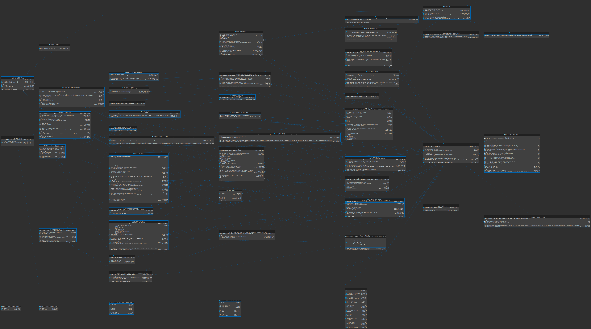

# Schema ADMSPCE16 (referência)

- **`data/`** — **dados iniciais** extraídos do banco (mesmo esquema `ADMSPCE16`), em JSON, para desenvolvimento, testes e referência de FKs. São catálogos e tabelas de apoio que já existem no ambiente real e que outras tabelas (EPC_*, cadastros) referenciam. Ver [Dados iniciais (`data/`)](#dados-iniciais-data) abaixo.
- **`admspce16-schema.sql`** — DDL exportado (DBeaver), esquema **`ADMSPCE16`**: tabelas de prestação de contas eleitoral (EPC_*), cadastros auxiliares (DRD, UE, AEROPORTO, eleição, etc.), índices e FKs.
- **`admspce16-views.sql`** — definições de **views** (`VW_*`): bem/serviço imobilizado, totais para atualização de receita/despesa, sobra não financeiro 4.2 e pivot. Usam sintaxe típica do export (ex.: `NVL`, `DECODE`, `CASEWHEN`, `CREATE FORCE VIEW`) — podem precisar de ajuste para outro motor.
- **`admspce16-sequences.md`** — **sequências** (`SQ_EPC_*`): valor atual, min/max, incremento (referência para geradores de ID ou alinhamento com o banco).
- **`admspce16-tipos-dados.md`** — **tipos de dados** do catálogo (H2/JDBC): precisão e escala por nome de tipo.
- **`ADMSPCE16.png`** — **diagrama ER** exportado do DBeaver (visão geral de tabelas e relacionamentos). Atualize ao mudar o modelo no banco.

## Diagrama ER



Uso:

- Consulta para nomes de **tabelas**, **colunas** e **views** ao escrever SQL no app ou no `jdbc-sidecar`.
- **Não** é script de migração automática: revisar sintaxe e compatibilidade com o H2/servidor antes de executar.
- Ao atualizar o banco no DBeaver, substitua ou regenere estes arquivos e mantenha o histórico no Git se fizer sentido.

Para o Cursor: mencione `@docs/database`, `@docs/database/data`, `@ADMSPCE16.png`, `@admspce16-schema.sql`, `@admspce16-views.sql`, `@admspce16-sequences.md` ou `@admspce16-tipos-dados.md` nas conversas sobre modelo de dados.

## Dados iniciais (`data/`)

A pasta **`docs/database/data/`** contém **snapshots em JSON** das linhas já presentes no banco para tabelas de **cadastro e catálogo**. Eles servem como:

- **Referência** de códigos e descrições ao implementar repositórios, validações e telas.
- **Base para seeds** em ambiente local ou testes (importar/aplicar conforme a estratégia do projeto).
- **Apoio a FKs**: várias tabelas da prestação referenciam esses registros (ex.: `UE`, `AEROPORTO`, tipos e domínios).

### Formato

Cada arquivo é um objeto JSON com **uma chave** igual ao **nome da tabela** e valor **array de objetos** (uma linha por objeto; propriedades = nomes de coluna, alinhados ao DDL em `admspce16-schema.sql`).

Exemplo ilustrativo:

```json
{
  "NOME_TABELA": [
    { "COLUNA_1": "valor", "COLUNA_2": 123 }
  ]
}
```

### Arquivos

| Arquivo | Tabela | Uso típico |
|---------|--------|------------|
| `AEROPORTO.json` | `AEROPORTO` | Aeroportos; FK `SG_UE` → `UE` |
| `CONFIGURACAO_ELEICAO.json` | `CONFIGURACAO_ELEICAO` | Parâmetros por eleição |
| `DRD.json` | `DRD` | Distritos regionais eleitorais |
| `EPC_ERRO.json` | `EPC_ERRO` | Catálogo de erros/mensagens EPC |
| `ESPECIE_RECURSO.json` | `ESPECIE_RECURSO` | Espécies de recurso |
| `FONTE_AVALIACAO.json` | `FONTE_AVALIACAO` | Fontes de avaliação |
| `FUNCAO.json` | `FUNCAO` | Funções (cadastro auxiliar) |
| `GRUPO_INFORMACAO.json` | `GRUPO_INFORMACAO` | Grupos de informação |
| `INSTITUICAO_FINANCEIRA.json` | `INSTITUICAO_FINANCEIRA` | Instituições financeiras |
| `MODELO_DOCUMENTO.json` | `MODELO_DOCUMENTO` | Modelos de documento |
| `TIPO_ARQUIVO_COMPROVANTE.json` | `TIPO_ARQUIVO_COMPROVANTE` | Tipos de arquivo de comprovante |
| `TIPO_BEM.json` | `TIPO_BEM` | Tipos de bem |
| `TIPO_DOCUMENTO.json` | `TIPO_DOCUMENTO` | Tipos de documento |
| `TIPO_LOGRADOURO.json` | `TIPO_LOGRADOURO` | Tipos de logradouro |
| `UE.json` | `UE` | Unidades eleitorais (hierarquia BR → UF → município, etc.) |

**Observação:** `UE.json` é volumoso (milhares de registros); prefira buscar por `SG_UE` ou ferramentas de consulta ao invés de abrir o arquivo inteiro no editor.

Ao **atualizar** o banco de referência, regenere ou substitua os JSON correspondentes para manter paridade com o DDL e com o ambiente real.
