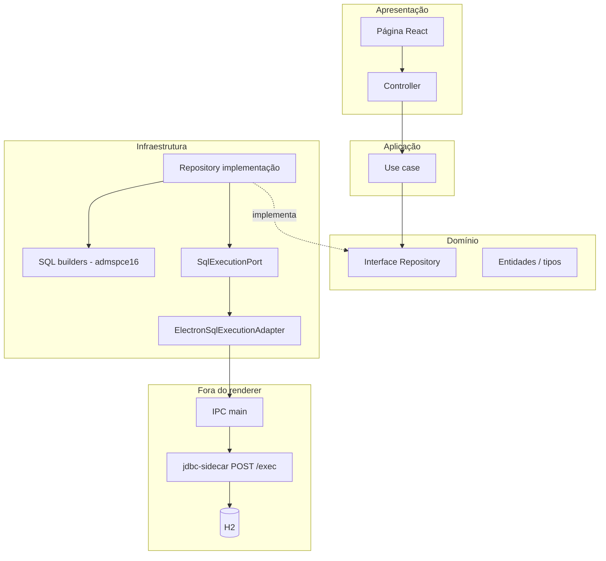

# Renderer: fluxo padronizado do DI até `sql.exec`

Este documento descreve a **pilha fixa** usada no `renderer/` para qualquer funcionalidade que execute SQL no H2 via **jdbc-sidecar** (Electron → IPC → HTTP → JDBC). O **caso de referência** é o módulo de **candidatos** (`Candidate*`).

## Visão geral

**Resumo:** a página obtém o **controller** pelo **DI container**; o controller chama **use cases**; o use case orquestra **regras de negócio** e chama a **interface** do repositório; a implementação monta ou usa **strings SQL** (arquivo dedicado em `infrastructure/sql/admspce16/`) e executa via **`SqlExecutionPort.exec`**, que no app desktop vira **`window.api.invoke`** com payload **`SqlExecInput`**.

## 1. Tipos e contrato de execução SQL

| Item | Onde |
|------|------|
| Payload `SqlExecInput` | `shared/src/ipc.ts` — `{ connection: { host }, query }` |
| Endpoint IPC | `@spce/shared`: `ApiEndpoint.exec` (`'/exec'`) |
| Porta | `renderer/.../ports/SqlExecutionPort.ts` — `exec(input): Promise<SqlExecResult>` |
| Resultado | `renderer/.../types/SqlExecResult.ts` — `{ query, results }` (array para SELECT, número para DML) |

O **host** padrão costuma vir de `infrastructure/config/databaseDefaults.ts` (`DEFAULT_DB_HOST`).

## 2. Adapter: Electron → IPC

**Arquivo:** `renderer/src/infrastructure/adapters/ElectronSqlExecutionAdapter.ts`

- Implementa `SqlExecutionPort`.
- Chama `window.api.invoke({ channel, endpoint: ApiEndpoint.exec, input })`.
- Se não houver Electron (ex.: Vite puro), lança erro informando que é preciso o shell desktop.

**Não** é necessário criar um adapter novo por feature: **um adapter** serve todos os repositórios SQL.

## 3. Repositório

**Interface:** `renderer/src/domain/repositories/<Feature>Repository.ts`

- Métodos de negócio com nomes claros (`findAll`, `insertX`, …), **sem** expor SQL cru para fora.
- Tipos de domínio (`NormalizedInsertCandidate`, entidades) como parâmetros/retornos quando fizer sentido.

**Implementação:** `renderer/src/infrastructure/repositories/ElectronSql<Feature>Repository.ts`

- Recebe `SqlExecutionPort` + host (ou só port e lê host de constante).
- Métodos privados `execUpdate` / `execQueryRows` centralizam `this.sql.exec({ connection: { host }, query })` e interpretam `results`.
- **Montagem de SQL** não precisa ficar no mesmo arquivo: extrair para **`renderer/src/infrastructure/sql/admspce16/<feature>RepositorySql.ts`** (funções `build…Sql`, constante `…_SELECT_ALL_SQL`, schema `ADMSPCE16`).

**Utilitários reutilizáveis:**

- `infrastructure/sql/sqlStringUtils.ts` — literais e `NULL` seguros.
- `infrastructure/sql/jdbcRowUtils.ts` — leitura de colunas em linhas genéricas.

## 4. Casos de uso

| Tipo | Pasta sugerida |
|------|----------------|
| Somente orquestração + regras de processo | `renderer/src/application/usecases/` |
| Leitura simples | pode permanecer em `domain/usecases/` (ex.: `GetAllCandidatesUseCase`) |

**Insert / fluxos multi-passo:** o use case em `application/` deve:

1. Normalizar/validar entrada (método **privado** no use case ou helpers de domínio).
2. Chamar o repositório na ordem correta.
3. Lançar erros de negócio se contagens ou resultados forem inválidos.

## 5. Apresentação

**Controller:** `renderer/src/presentation/controllers/<Feature>Controller.ts`

- Recebe use cases no construtor.
- Converte entidades de domínio em view models quando necessário.

**Página:** `renderer/src/pages/...`

- Usa `getDIContainer()` de `infrastructure/di/DIContainer.ts` para obter o container da feature e o controller.

## 6. Injeção de dependências (DI)

**Root:** `renderer/src/infrastructure/di/DIContainer.ts`

- Singleton `getInstance()` / `getDIContainer()`.
- Expõe getters por domínio (`candidates`, `airports`, …).

**Por feature:** `renderer/src/infrastructure/di/containers/<Feature>Container.ts`

Ordem típica de criação (lazy):

1. `ElectronSqlExecutionAdapter` (singleton dentro do container).
2. `ElectronSql*Repository` (adapter + `DEFAULT_DB_HOST`).
3. Use cases (dependem do repositório).
4. Controller (depende dos use cases).

`reset()` zera referências (útil em testes ou reload).

## 7. Checklist para uma nova feature SQL

1. **DDL / modelo:** consultar `docs/database/admspce16-schema.sql` e regras em `.cursor/rules/database-schema.mdc`.
2. **Domínio:** entidades, tipos normalizados, interface `*Repository`.
3. **SQL:** arquivo em `infrastructure/sql/admspce16/<nome>RepositorySql.ts` com `build…` e constantes de SELECT.
4. **Repositório:** implementação fina chamando builders + `SqlExecutionPort`.
5. **Use case:** em `application/usecases/` se houver processo/regras; senão `domain/usecases/`.
6. **Controller + página** (se houver UI).
7. **DI:** novo `*Container` ou métodos no existente; registrar em `DIContainer`.
8. **Teste manual:** app **Electron** + jdbc-sidecar; Vite sozinho não executa SQL real.

## 8. Referência de arquivos (candidatos)

| Camada | Arquivos |
|--------|----------|
| DI | `infrastructure/di/DIContainer.ts`, `infrastructure/di/containers/CandidateContainer.ts` |
| Port / adapter | `ports/SqlExecutionPort.ts`, `adapters/ElectronSqlExecutionAdapter.ts` |
| SQL builders | `infrastructure/sql/admspce16/candidateRepositorySql.ts` |
| Repositório | `domain/repositories/CandidateRepository.ts`, `infrastructure/repositories/ElectronSqlCandidateRepository.ts` |
| Use case | `application/usecases/InsertCandidateUseCase.ts`, `domain/usecases/GetAllCandidatesUseCase.ts` |
| API UI | `presentation/controllers/CandidateController.ts`, `pages/CandidatesPage.tsx` |

---

*Última revisão alinhada ao padrão “candidato” no monorepo `apps`.*
